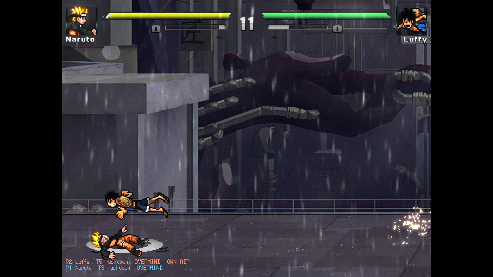

  

# Woo Force Next

  
  
  
  
  
  

<strong>A playable anime fighting game on Ikemen GO, with an AI brain that makes AI-vs-AI fights worth watching.</strong>

*Actual normal-speed combat capture from the beta.2 verification run. Character and stage artwork belongs to its respective authors.*

  <a href="#download-the-game-beta">Download</a> ·
  <a href="docs/INSTALL.md">Install</a> ·
  <a href="docs/HOW-IT-WORKS.md">How it works</a> ·
  <a href="docs/TESTING.md">Testing</a> ·
  <a href="docs/KNOWN-ISSUES.md">Known issues</a> ·
  <a href="CHANGELOG.md">Changelog</a>

> [!WARNING]
> **This is BETA software. The current brain and tools are 0.9.0-beta.2, installed over the 0.9.0-beta.1 full-game download.** It is unfinished and has known bugs.
> Fights, balance and file formats will change between betas without notice. The roster is a first cut (see below).
> Please read [what BETA means here](#beta-what-that-means-here) before you try it, and report what you see.

## Download the game (BETA)

The [beta.2 upgrade](../../releases/tag/v0.9.0-beta.2) fixes round-result learning and test reliability. It contains the updated brain, bridge and complete Python toolkit; it preserves player settings, character profiles and learned data. A current source checkout already includes these fixes. See [CHANGELOG.md](CHANGELOG.md).

The playable game is a **pre-release** made of 23 ZIP parts (39.7 GiB to download, about 58 GiB once extracted): **[download 0.9.0-beta.1](../../releases/tag/v0.9.0-beta.1)**.

1. Make an empty folder (not inside Program Files).
2. Download **every** `Woo-Force-Next-Game-0.9.0-beta.1-partNN.zip` and extract them all into that folder, in any order, merging folders.
3. Optional: check the files against `SHA256SUMS.txt`.
4. Download `Woo-Force-Next-Upgrade-0.9.0-beta.2.zip` from the [beta.2 release](../../releases/tag/v0.9.0-beta.2). Close the game, back up your existing brain/bridge/tool files, then extract the upgrade into the same game folder and replace those files. Do not extract it into a second nested folder. Verify its checksum against the beta.2 `SHA256SUMS.txt`.
5. Run `Ikemen_GO.exe` and pick **Watch mode** (AI vs AI), or any other mode. The brain log should identify `0.9.0-beta.2`.

Already have the full beta.1 game? Download only the upgrade. It contains no characters, engine, saves, configuration, roster profiles or learned data. The development tools optionally need Python and `pip install -r woo/tools/requirements.txt`; playing needs no Python. To recover only the missing batch CSV from existing profiles, run `python woo/tools/roster_analyzer.py --summary-only`.

Needs Windows 10/11 64-bit, a GPU with OpenGL 3.3, and about 60 GiB of free disk. It starts full screen at 1920x1080 with MSAA 4; change that in `save/config.ini`.

**What is in this beta's roster:** 996 anime characters, the original Jump Force-style set (Dragon Ball, Naruto, One Piece, Bleach, JoJo,
One Punch Man, Saint Seiya, Fairy Tail, My Hero Academia and more; the list with each character's author is
[docs/ROSTER.tsv](docs/ROSTER.tsv)). **Not included for now:** the custom additions made after that set (non-anime, original and adult characters).

## What it is

Woo Force Next is an Ikemen GO remake of a very large MUGEN roster (Woo Force). The game download bundles the engine, a screenpack,
the characters and stages. This repository holds the original work on top of that: the **AI brain** (Lua + ZSS mod), the **roster
knowledge** it reads (power tiers, personas, lore, canon partners and rivals) and the **tools** used to build, check and test it.

The goals: every character fights as itself, strong ones win but weak ones can come back, fighters from the same universe know each
other, canon partners team up, and nothing looks broken.

## BETA: what that means here

- **Unfinished.** Behaviour, balance and data formats change between betas. A 0.9.x release can break your settings or generated data.
- **One machine.** Built and tested on Windows 11 with Ikemen GO v1.0.0. Other systems and other engine versions are untested.
- **Automated tests only so far.** The numbers below come from headless AI-vs-AI matches at 4x speed. A human play-test of this exact build
  in Watch mode is still pending.
- **Known problems exist.** See [docs/KNOWN-ISSUES.md](docs/KNOWN-ISSUES.md). Some characters stall, deadlock or look odd; a few are
  character bugs the brain cannot fix. The characters are community-made and vary in quality.
- **First-cut roster.** Only the 996 characters above are in; more will follow once they have been checked.

## What is where

| In this repository (MIT, the code) | In the release download (not in git) | Not available |
|---|---|---|
| `external/mods/woo_brain.lua`, the brain | The whole game, ready to run: Ikemen GO v1.0.0 (MIT), the screenpack, 996 characters, stages, sounds | The custom, non-anime and adult characters |
| `data/woo_brain.zss`, the input and power-scaling bridge | `Woo-Force-Next-Brain-0.9.0-beta.1.zip`: only the brain, knowledge files and analyzer, for people who already have an Ikemen GO install | |
| `woo/profiles.ini`, `lore.txt`, `lore_extra.txt`, `duos.txt`, `series.txt` (tiers, personas, lore, partners) | | |
| `woo/tools/`: analyzer, game-pack builder, test harness, health and palette tools | | |
| `docs/ROSTER.tsv`: the roster with each character's author | | |
| `patches/`: one small fix for stock Ikemen GO v1.0.0 | | |

## Features

- **Six power tiers** set how fast a fighter reacts, how well it decides, its AI level and its attack and defence multipliers.
- **Eight personas** (effortless, tactician, zoner, rushdown, warrior, berserker, trickster, brawler) decide spacing, aggression, guarding,
  jumping, projectile and meter habits.
- **Three modes per fighter.** *Overmind* (the default) keeps the character's own AI and adds a decision layer on top; *pilot* drives
  characters that have no AI at all through a virtual controller; *coach* only sets the AI level and power scaling (forced, for A/B tests).
- **Finisher discipline.** Supers wait until the enemy is hurt, the bigger the move the longer it waits. A super that starts too early is
  cancelled, and the brain learns per-character ceilings.
- **Comebacks.** A *second wind* buffs the underdog after a lost round; *fighting spirit* gives a one-time swing at 25% life.
- **Familiarity and learning.** Strangers scout each other's moves; fighters adapt between rounds.
- **Team play.** Canon partners relay combos, rescue each other and open supers together.
- **Watch-mode stall breaker.** A round that stops making progress ends as a time over after 2 minutes.
- **Live controls.** `F7` cycles the brain overlay, `F8` switches the brain on and off, `-woo off` starts a match without it.

Details: [docs/HOW-IT-WORKS.md](docs/HOW-IT-WORKS.md).

## How well does it work?

The figures below are historical beta.1 reports. Its balance tools compared raw remaining health and could miss failed samples; treat tier/comeback percentages as provisional until rerun with the corrected beta.2 outcome checks. Current source regression commands are in [docs/TESTING.md](docs/TESTING.md).

Automated results, headless AI-vs-AI at 4x speed, 2026-10-22, brain 0.9.0-beta.1, measured on the author's full 1,637-character
development roster (the 996-character download is a subset of it). These measure the brain against its own goals; they are not a claim
about how it feels to watch.

| Check | Result |
|---|---|
| Supers starting before the enemy is hurt, 1v1 | **0 of 110** |
| Supers starting before the enemy is hurt, 2v2 | **0 of 124** |
| 1-round matches that stalled (20 matches) | **1 of 20** (a character deadlock that also happens with the brain off) |
| Higher tier wins a round, tier gap 1 / 2 / 3 / 4 | 36% / 85% / 79% / 100% |
| Underdog that lost round 1 takes round 2 | about 19-21%, and wins the match about 4 times in 37 |
| Brain cost | 0.41 ms per tick on average, 4.7 ms worst fight tick (2v2, 1x speed) |
| The download itself | 23 parts hash-checked, extracted copy boots with all 996 characters and plays AI-vs-AI matches with the brain; nobody has hand-played it yet |

How these were measured, and what they do not cover: [docs/TESTING.md](docs/TESTING.md).

## Already have an Ikemen GO install?

You can add just the brain to it: `Woo-Force-Next-Brain-0.9.0-beta.1.zip` from the release, or the files in this repository. Manual, Windows,
and untested outside the author's setup: [docs/INSTALL.md](docs/INSTALL.md).

The brain writes `woo/logs/brain.log` (version at start, one summary per round, every cancelled or held super, and any error).

## Reporting problems

Use the [bug report form](../../issues/new/choose) and attach the relevant part of `woo/logs/brain.log`. Security reports: see [SECURITY.md](SECURITY.md).

## Credits, licensing and takedowns

- **Ikemen GO** is MIT-licensed, by the [Ikemen GO contributors](https://github.com/ikemen-engine/Ikemen-GO). This project is a mod for it and is not affiliated with it.
- **Characters, stages, sounds and the screenpack** in the download were made by many community authors, who keep their rights; each
  character's author tag, taken from its own files, is in [docs/ROSTER.tsv](docs/ROSTER.tsv). The characters portrayed belong to their
  respective rights holders; this project is not affiliated with or endorsed by any of them.
- The original code and data files in this repository are under the [MIT license](LICENSE). That license does **not** cover the
  characters, stages, sounds or screenpack. `patches/` modifies an MIT-licensed Ikemen GO file and is offered under the same terms.
- **If you made or own something in the download and want it credited differently or removed,** open an issue here and it will be dealt with promptly.
- By SenjuWoo.
